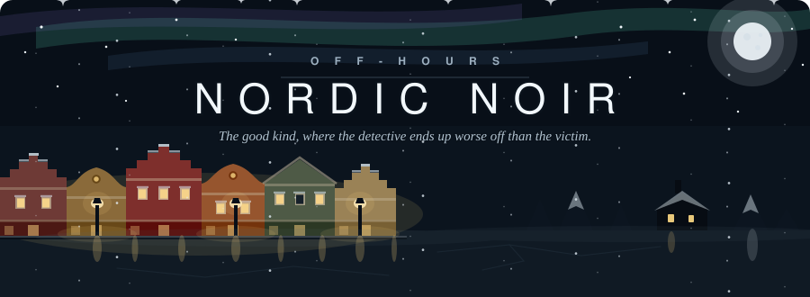

<h1 align="center">Tetiana Kravchuk</h1>

  <strong>Applied AI Engineer · Agent Evaluation · LLM Reliability</strong>

  I build source-grounded AI workflows for data-intensive products, with a focus on
  backend systems, evaluation, and safe operation.

  
  

## What I build

My current independent product work is **World Publishing Houses (WPH)**, a multilingual book-discovery platform. I work on research workflows, source-backed records and provenance, reviewer queues, evaluation, and safety controls. The core application repository is private; the case study and public examples below show selected work.

- **Agent and retrieval workflows:** connect a question to relevant records and source evidence, then make uncertainty visible.
- **Evaluation:** use golden cases and explicit checks for unsupported claims, factual consistency, and appropriate handling of unverified records.
- **Reliable operation:** add traces, failure visibility, human review, and deterministic controls around higher-risk decisions.

## Selected work

### [WPH LLM Evaluation](https://github.com/tetianakravchuk/wph-llm-eval)

A runnable evaluation harness for source-grounded answers. It includes deterministic checks, golden examples, regression tests, and an optional LLM-as-judge path. The cases target unsupported attributions, factual errors, language-code confusion, and unverified information presented as fact.

[View code](https://github.com/tetianakravchuk/wph-llm-eval) ·
[Evaluation case study](https://tetianakravchuk.com/projects/ai-evaluation-observability/)

### [AI Reliability Engineering Examples](https://github.com/tetianakravchuk/ai-reliability-engineering-examples)

A standalone PostgreSQL example of atomic observation ingestion and optimistic checkpoint updates. Integration tests exercise rollback, competing workers, interruption, and duplicate-write protection against a disposable database.

[View code](https://github.com/tetianakravchuk/ai-reliability-engineering-examples)

### [World Publishing Houses AI Platform](https://tetianakravchuk.com/projects/wph-ai-platform/)

An independent product case study covering multilingual discovery, source-backed ingestion, research workflows, reviewer tools, evaluation, and controlled promotion.

[Case study](https://tetianakravchuk.com/projects/wph-ai-platform/) ·
[Live platform](https://worldpublishinghouses.com) ·
[Video walkthroughs](https://tetianakravchuk.com/projects/wph-ai-platform/#technical-deep-dives)

### [Housing Price Prediction](https://github.com/tetianakravchuk/PredictHousingPrices)

A data-science project comparing regression and tree-based models with cross-validation, RMSE, MAE, R², residual analysis, and model-risk communication.

[View code](https://github.com/tetianakravchuk/PredictHousingPrices) ·
[Case study](https://tetianakravchuk.com/projects/housing-price-prediction/)

## Technical toolkit

**Applied AI and evaluation:** AI agents, retrieval and RAG, structured outputs, tool use, prompt versioning, golden datasets, groundedness checks, hallucination evaluation, human review, traces, and cost and latency monitoring.

**Backend and data:** Python, SQL, PostgreSQL, REST APIs, FastAPI, Docker, data validation, Git, CI/CD, and observability.

**Quality engineering:** 10+ years in software quality engineering and automation for data-intensive and financial products. Java, Python, PyTest, Selenium, Appium, REST Assured, Postman, TestNG, JUnit, Cucumber, and CI pipelines.

**Data science:** applied statistics, experiment design, regression, classification, model evaluation, and communication of model risk.

  
  
  
  
  
  
  
  

## Background and interests

M.S. in Data Science, AI & Machine Learning — Boston University, 2026. My software-engineering background shapes how I approach AI: behavior should be testable, observable, and safe to improve.

I’m open to full-time, U.S.-remote opportunities in Applied AI Engineering, AI Evaluation, AI Platform and Reliability, and AI Observability.

  

  

  Massachusetts, USA · U.S. citizen · Open to full-time U.S.-remote roles

